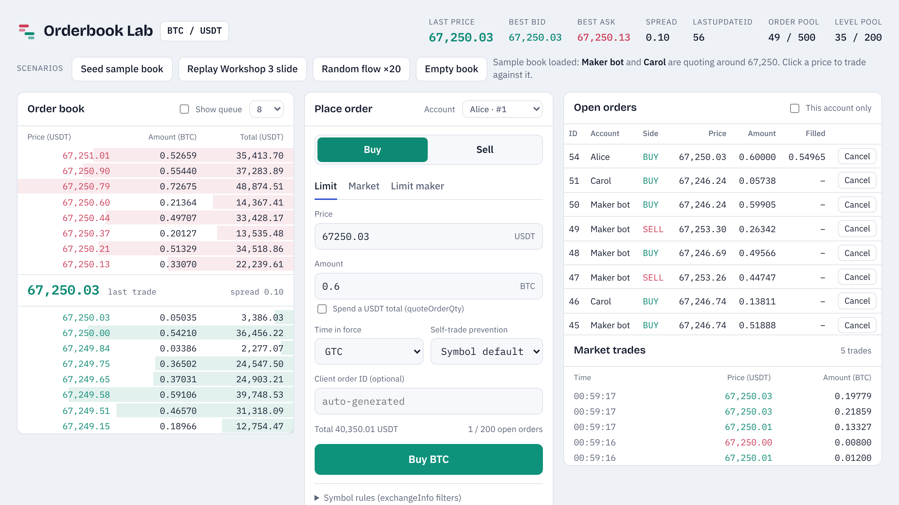
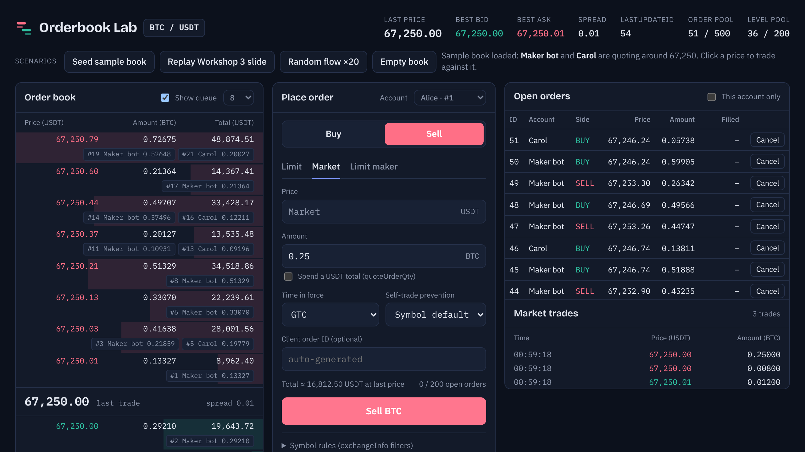
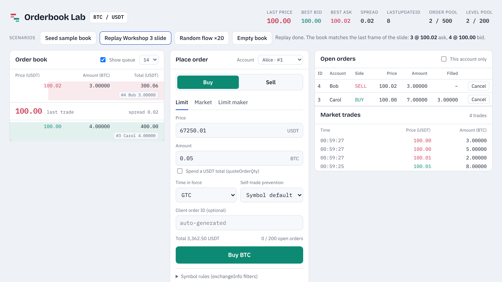
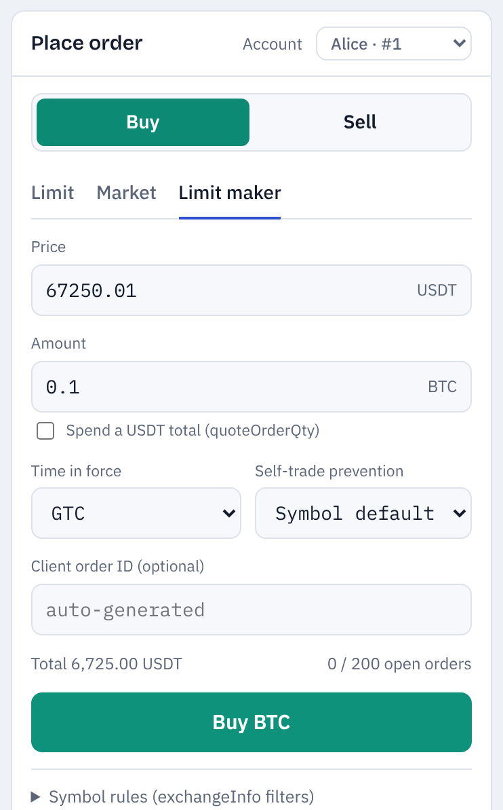
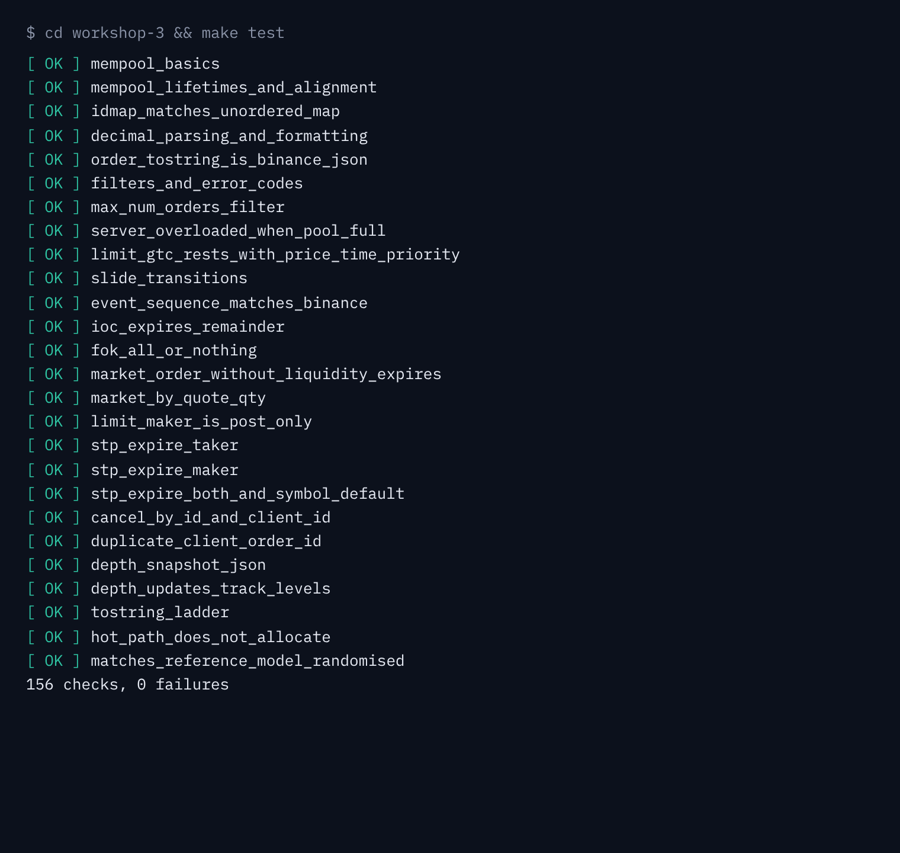
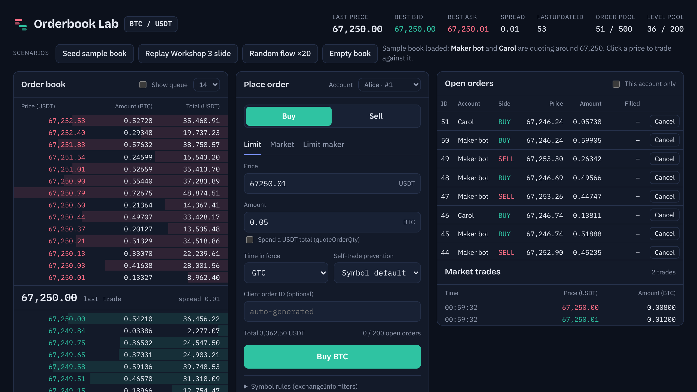

# C++ Build Project — Trading Exchange from Scratch

Homework for the Open Avenues **"C++ Systems for Finance: Build a Trading Exchange from Scratch"** workshops.

| Folder | Workshop | What's inside |
|---|---|---|
| [`workshop-2/`](workshop-2) | Intro to Modern C++ | `MemPool<T>`: pre-allocated, cache-local object pool with O(1) allocate/deallocate |
| [`workshop-3/`](workshop-3) | Exchange Order Book (Part 1) | `Order`, `OrderBook` (`add`, `cancel`, `toString`) on a crypto spot exchange model, allocating from `MemPool` |
| [`orderbook_lab.html`](orderbook_lab.html) | — | Clickable order book you can open in any browser. It runs a JavaScript port of the same matching rules |



## Run it

```bash
cd workshop-2 && make test      # 29 checks
cd workshop-3 && make test      # 156 checks
cd workshop-3 && make sanitize  # AddressSanitizer + UBSan
cd workshop-3 && make bench     # MemPool vs new/delete, order book ns/op
```

You need a C++20 compiler with `<format>` (GCC 13+ or Clang 17+ with libstdc++ 13).
To try the front end, download `orderbook_lab.html` and open it in a browser.

## Screenshots

| | |
|---|---|
|  |  |
| Dark mode, "Show queue" lists every resting order in time priority | "Replay Workshop 3 slide" ends exactly at the slide's last frame |
|  |  |
| A LIMIT_MAKER order that would cross is rejected with error `-2010` | `make test` in `workshop-3` |



## Design highlights

- **No heap allocation on the hot path.** Orders, price levels and hash-map slots are all reserved up front. A test overrides `operator new` and checks that 50,000 add/cancel calls allocate nothing.
- **Price-time priority.** Each price level is an intrusive FIFO list of pool nodes, so cancels are O(1). Each side keeps a sorted vector of levels with the best price at the back, so matching only touches `back()`.
- **Exact prices.** Prices and quantities are 8-decimal fixed-point integers (`"67250.01"_d`), never `double`.
- **Exchange behaviour:** LIMIT / MARKET / LIMIT_MAKER, GTC / IOC / FOK, symbol filters, self-trade prevention, exchange error codes, and `executionReport` / `trade` / `depthUpdate` events.
- **Checked against a reference model.** 100,000 random operations give the same trades and book state as a simple `std::map` order book.
