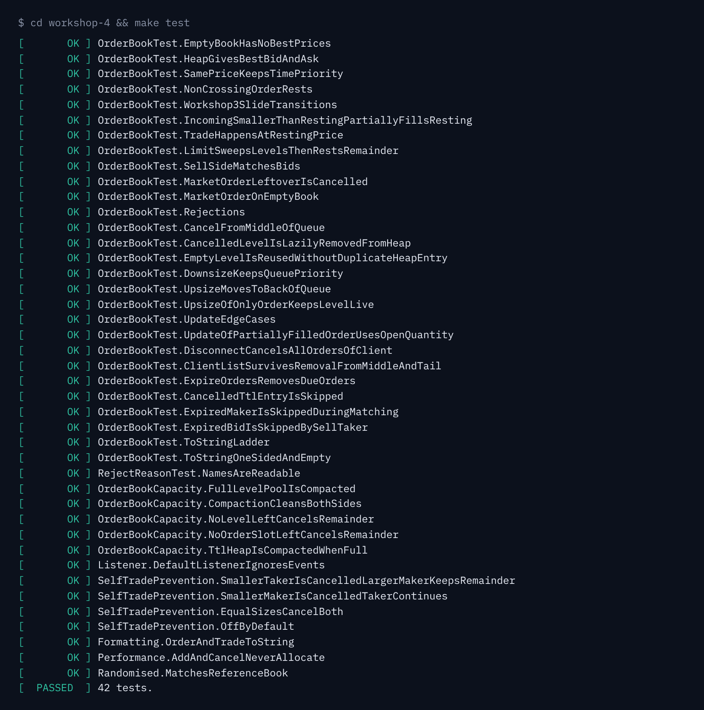
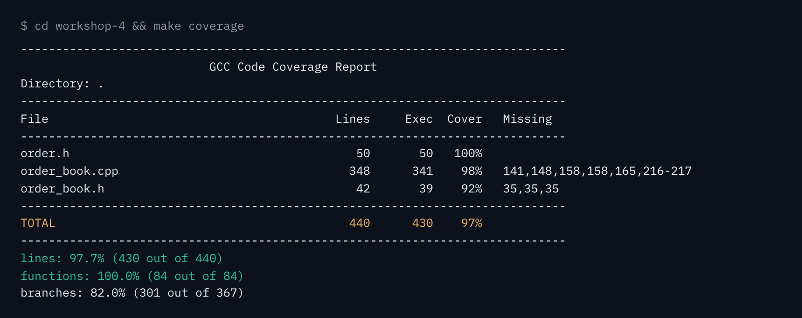

# Workshop 4: Exchange Order Book (Part 2)

Homework for the Open Avenues **"C++ Systems for Finance: Build a Trading Exchange from Scratch"** workshops.

**Homework:**
- Complete the priority queue implementation in `order_book.h` and `order_book.cpp`
- Test it in `order_book_test.cpp` (GoogleTest), with at least 80% coverage
- Optional: the additional features (`update`, `disconnect`, TTL, decrement-and-cancel self-trade prevention)

**Result:** 42 GoogleTest tests pass; coverage is **97.7% of lines** and **100% of functions**; AddressSanitizer + UBSan report nothing.

| File | Contents |
|---|---|
| `order.h` | `Order` (ticker, ids, side, limit/market, price in ticks, quantity, filled, TTL, status) with `toString()` |
| `order_book.h` | `ReservedHeap` (a `std::priority_queue` with pre-reserved storage), `ForBids` / `ForAsks` comparators, `OrderBook` API |
| `order_book.cpp` | Matching, lazy deletion, compaction, `update`, `disconnect`, TTL, self-trade prevention, `toString` |
| `order_book_test.cpp` | GoogleTest suite (`OrderBookTest` fixture), including a randomised check against a `std::map` reference book |
| `mem_pool.h`, `id_map.h` | Memory pool from Workshop 2 and the fixed-capacity hash map from Workshop 3 |
| `CMakeLists.txt`, `Makefile` | Build; GoogleTest v1.15.2 is downloaded automatically |

## Design

```
bids: std::priority_queue<Price, vector<Price>, ForBids>   (max-heap: top = highest bid)
asks: std::priority_queue<Price, vector<Price>, ForAsks>   (min-heap: top = lowest ask)
        │  one heap entry per PRICE, not per order
        ▼
IdMap<Price → PriceLevel*>  ──►  PriceLevel: FIFO list of orders (head = oldest)
IdMap<OrderId → Node*>      ──►  O(1) cancel / update
IdMap<ClientId → Node*>     ──►  per-client list for disconnect()
min-heap<(expire_at, id)>   ──►  TTL expiry
```

- **The heap holds price levels, not orders.** Orders at the same price wait in a FIFO list, so time priority is exact and the heap stays small.
- **Lazy deletion** (from the slides). Cancelling the last order at a price leaves an empty level in the heap. When it reaches the top, `bestLevel()` pops and frees it. If an order arrives at that price first, the same level is reused, so each price is in the heap at most once.
- **Compaction.** If the level pool fills up with empty levels, the heap's array is filtered and rebuilt with `make_heap`. This is O(n) but rare.
- **No heap allocation while trading.** The heaps' vectors are reserved up front (`ReservedHeap`), and orders and levels come from `MemPool`. A test checks that 50,000 add/cancel calls allocate nothing.

## Complexity (L = price levels, n = orders)

| Operation | Naive vector | `std::map` | **This priority queue** | Workshop 3 (sorted vector) |
|---|---|---|---|---|
| Best bid / ask | O(n) | O(log L) | **O(1) peek** (amortised, after lazy pops) | O(1) |
| Add at a new price | O(1) | O(log L) | **O(log L)** push | O(log L) + shift |
| Add at an existing price | O(1) | O(log L) | **O(1)** (hash map lookup) | O(log L) |
| Cancel | O(n) | O(1) with an id map | **O(1)** unlink + lazy heap cleanup | O(1) + level removal |
| Depth in price order | O(n log n) | O(L) | O(L log L) (copy + sort) | O(L) |

## Features

| Feature | Behaviour |
|---|---|
| `add(order)` | Matches using the slide's flowchart: best price first, then oldest; trades at the resting price; a limit remainder rests and a market remainder is cancelled |
| `cancel(orderId)` | O(1) unlink; an empty level is removed lazily |
| `update(orderId, newQty)` | Reducing the size **keeps queue priority**; increasing it **moves the order to the back** of its level; 0 cancels |
| `disconnect(clientId)` | Cancel-on-disconnect: removes every resting order of that client |
| TTL | `Order::limit(..., expire_at)`; `setTime(now)` is the book's clock; `expireOrders()` removes due orders, and an expired order is never traded |
| Self-trade prevention | `StpMode::DecrementAndCancel`: the smaller quantity is cancelled from both orders, the larger keeps its remainder, and price-time priority still holds |
| Events | `OrderBookListener::onTrade` and `onOrderEvent` (Accepted, Traded, Canceled, Expired, Updated, SelfTradeCanceled) |

## Run

### Bazel (as in the workshop)

```bash
bazel test //:order_book_test --test_output=errors
bazel coverage //:order_book_test
genhtml "$(bazel info output_path)/_coverage/_coverage_report.dat" -o coverage_html   # needs lcov
```

`MODULE.bazel` pulls GoogleTest 1.15.2 from the Bazel Central Registry, `.bazelversion` pins Bazel 7.4.1, and `.bazelrc` sets C++20 and limits coverage to `//:order_book`.
On macOS with Apple Clang, set these before `bazel coverage`:

```bash
export BAZEL_USE_LLVM_NATIVE_COVERAGE=1 GCOV="$(xcrun -f llvm-profdata)" BAZEL_LLVM_COV="$(xcrun -f llvm-cov)"
```

### CMake (alternative)

```bash
make test        # CMake build + GoogleTest
make coverage    # gcovr summary (fails if lines < 80%) + build-coverage/coverage.html
make clean
```

Requirements: a C++20 compiler with `<format>` (GCC 13+ or Clang 17+); for CMake, also CMake 3.20+ and git; for coverage, `gcovr` (`pip install gcovr`).
On macOS with Apple Clang, run `make coverage GCOV="xcrun llvm-cov gcov"`.

### What coverage does not prove

97.7% line coverage only shows which lines ran, not that every case is correct. These tests check behaviour directly:
- The randomised test runs 50,000 orders and cancels and compares every trade, price and quantity with a simple `std::map` reference book.
- Edge cases: an order whose remainder can't rest, compaction of empty levels, updates on a partly filled order, an expired order on either side, and self-trade with equal sizes.



