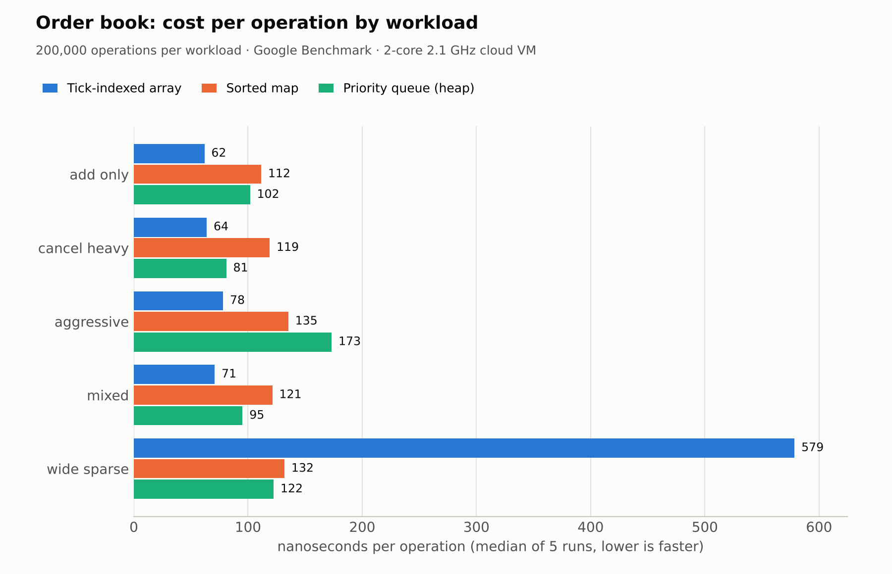

# Workshop 5: Optimizing the Order Book

Homework for the Open Avenues **"C++ Systems for Finance: Build a Trading Exchange from Scratch"** workshops.

**Homework:**
- Implement the tick-sized array version
- Optional: also implement the sorted map version
- Benchmark and compare: generate different types of workloads, feed them into the different implementations, and use Google Benchmark

**Result:** three order books with the same API, 52 GoogleTest tests run against all of them (97.4% line coverage of the new code), and a Google Benchmark suite with five workloads plus a market-data depth test.



## The three implementations

| File | Price layer | Orders at one price | Cancel by id |
|---|---|---|---|
| `tick_order_book.h/.cpp` (**new**) | `vector<Level>` indexed by `(price − min) / tick`, with cached `best_bid_` / `best_ask_` indices | intrusive FIFO list of `MemPool` nodes | `IdMap` → node, O(1) unlink |
| `map_order_book.h/.cpp` (**new**, optional) | `std::map<Price, Level>` (bids with `greater<>`, so `begin()` is always the best price) | `std::list<Order>` | `unordered_map<OrderId, {Level*, list iterator}>`, O(1) erase |
| `heap_order_book.h/.cpp` (from Workshop 4) | `std::priority_queue` of prices with lazy deletion | intrusive FIFO list of `MemPool` nodes | `IdMap` → node, O(1) unlink |

The sorted-map book is written the idiomatic STL way, as on the slides. Every new price and every order allocates a node on the heap, which is exactly the "node-based, cache-unfriendly" cost the slides describe.

### How the tick-indexed array works

```
index = (price − min_price) / tick          e.g. min 99.97, tick 0.01

 [0]     [1]     [2]     [3]     [4]     [5]     [6]     [7]     [8]
 empty   BID 4   empty   BID 12  BID 2   ASK 3   ASK 1   empty   ASK 6
 99.97   99.98   99.99   100.00  100.01  100.02  100.03  100.04  100.05
                                   ▲        ▲
                              best_bid_  best_ask_
```

- **add:** compute the index (O(1)), append to that slot's FIFO list, and move `best_bid_` / `best_ask_` if the new price is better.
- **match:** take the oldest order at `levels_[best_ask_]` (or `best_bid_`) and trade at that price.
- **cancel:** O(1) lookup in the id map, O(1) unlink. If the best level empties, step outward to the next non-empty slot. That step is the only part that isn't O(1): it costs the number of empty ticks skipped.
- **Optimisation:** when a side has no orders left, its best index is reset to "none" directly instead of scanning the whole range. `depth()` also stops as soon as it has listed every live level.
- **Memory:** a fixed `vector<Level>` covering the whole price range, here 100,001 ticks × 32 bytes ≈ 3.2 MB, allocated once in the constructor. Prices outside the range or off the tick grid are rejected (`OutOfRange`).

## Workloads

All workloads are generated from a fixed seed (`workloads.h`), so each implementation gets exactly the same sequence of 200,000 operations. The generator replays the stream against a reference book while it builds it, so every cancel targets an order that is really resting, and the book keeps a realistic size.

| Workload | What it does | Orders resting at the end |
|---|---|---|
| `add_only` | passive limit orders within 200 ticks of the touch; nothing trades | 200,000 |
| `cancel_heavy` | 49% adds, 49% cancels, 2% small market orders (≈25 cancels per trade, like real markets) | 19,639 |
| `aggressive` | 50% passive adds near the touch, 50% orders crossing 0–5 ticks deep (matching-heavy) | 4,783 |
| `mixed` | 45% passive adds, 35% cancels, 10% orders around the mid, 10% market orders | 34,309 |
| `wide_sparse` | about 900 orders spread over ±40,000 ticks; 45% adds, 45% cancels (half at the best price), 10% market | 885 |

Each benchmark builds a fresh book and loads a prefill of 20,000 orders (2,000 for `wide_sparse`) with the timer paused. It then times the 200,000 operations, and reports the median of 5 repetitions.

## Results

Median nanoseconds per operation (lower is better). Measured on a 2-core 2.1 GHz cloud VM with GCC 13 at `-O3` (CMake Release); absolute numbers will differ on your machine, but the ranking should hold.

| Workload | Tick-indexed array | Sorted map | Priority queue |
|---|---|---|---|
| add_only | **62** | 112 | 102 |
| cancel_heavy | **64** | 119 | 81 |
| aggressive | **78** | 135 | 173 |
| mixed | **71** | 121 | 95 |
| wide_sparse | 579 | 132 | **122** |

Market data: the time to read the top 10 levels on both sides (`depth10`):

| Book state | Tick-indexed array | Sorted map | Priority queue |
|---|---|---|---|
| mixed (321 levels) | **21 ns** | 67 ns | 31,190 ns |
| wide_sparse (881 levels over 80,000 ticks) | 6,153 ns | **64 ns** | 248,452 ns |

## What the numbers show

1. **For a dense book, the tick-indexed array is fastest everywhere:** about 1.5–2× faster than the sorted map. Every operation is an array index plus a few pointer updates, in memory that is mostly contiguous and already allocated.
2. **It loses badly when the book is sparse** (579 vs 132 ns, and 6 µs vs 64 ns for depth). Each time the best level empties, the array has to step over dozens of empty ticks, and depth scans past empty slots. This is the caveat on the comparison slide: "fast, but preallocates the whole tick range" and "scan empty ticks". Use the array for liquid instruments with a tight price band, and a map for wide or sparse ones.
3. **The sorted map is the steady all-rounder.** It's never the fastest on a dense book, because every new level and every order is a heap allocation, followed by pointer chasing. But its speed hardly changes between dense and sparse books, and depth is always cheap because the map is already sorted.
4. **The priority queue is weak at matching and very weak at market data.** `aggressive` (the most matching) is its worst workload, because every exhausted level is a heap pop at O(log k). Reading depth means copying and sorting the heap, plus skipping lazily deleted "tombstone" levels, so it's hundreds to thousands of times slower than the others. It does well on `cancel_heavy` only because this version is not a textbook heap: it cancels through a hash map in O(1) and removes empty levels lazily. A heap of orders would need an O(n) search for every cancel.
5. **Takeaway:** cancels and market-data reads separate these structures, not matching speed. A real exchange uses the tick array for dense instruments and a map for sparse ones, and never a plain heap.

## Tests

`order_book_test.cpp` uses a **typed test suite** (`TYPED_TEST`), so the same 15 behaviour tests run against all three books: price-time priority, the Workshop 3 slide scenario, partial fills, sweeps, market orders, rejections, cancels and depth. One of them replays 30,000 random orders and cancels and checks that each book makes exactly the same trades as the sorted-map book.

Six more tests cover the tick array specifically, plus one shared formatting test:
- the slide's 9-tick ladder layout
- out-of-range and off-tick rejection
- the best index stepping outward over empty ticks
- emptying a level that isn't the best
- a full pool
- a test proving add and cancel never allocate memory

**Coverage:** 97.4% of lines in the new code (`tick_order_book`, `map_order_book`, `book_types`). AddressSanitizer and UBSan report nothing.

## Run

### Bazel

```bash
bazel test //:order_book_test --test_output=errors
bazel run //:order_book_bench -- --benchmark_repetitions=5 --benchmark_report_aggregates_only=true
bazel coverage //:order_book_test
```

### CMake

```bash
make test        # build + 52 GoogleTest tests
make bench       # Google Benchmark, writes bench_results.json
make coverage    # gcovr report for the new books, fails under 80%
```

Requirements: a C++20 compiler with `<format>` (GCC 13+ or Clang 17+). CMake downloads GoogleTest 1.15.2 and Google Benchmark 1.9.1 automatically; Bazel gets them from the Bazel Central Registry. `bench_results.json` holds the raw results behind the tables above.
